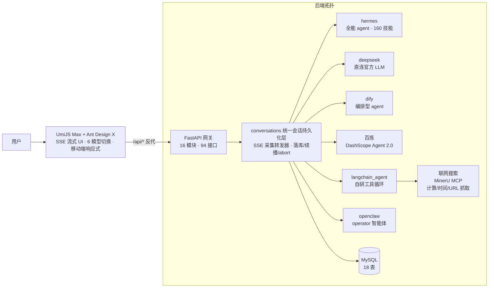
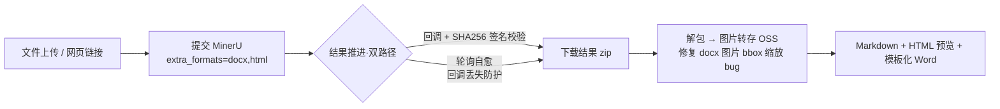

# Smart Assistant · 智能助手平台

> 多 LLM 后端统一的 AI 助手平台：6 种对话后端（含自研 LangChain Agent 与 OpenClaw 智能体）共享一套会话持久化与流式转发架构，前端一套 UI 全部覆盖。

## 项目亮点

- **多后端适配架构**：6 种 LLM 对话后端按上游形态分别采用三种集成模式（OpenAI 兼容直通 / 事件流翻译适配器 / 自研工具循环），新增后端零改前端
- **统一会话持久化层**：采集/响应解耦的 SSE 转发器——断线续播（0.8s 节流落库）、手动中止落库 aborted 态、多租户越权保护
- **MCP 协议接入**：streamable_http（托管）/ stdio（本地）双 transport 可配，服务端故障自动降级不阻断对话
- **大模型切题流水线**：试卷图片 → 阿里云 EduTutor 结构化切题（题干/选项/子题插图）→ 快照沉淀，前端 Canvas 画框交互
- **自研 LangChain 工具循环**：手动 tool-calling（非 LangGraph），内置联网搜索（DeepSeek Search/Fetch 计费 API）、MinerU 文档解析、防 SSRF URL 抓取、AST 白名单计算器，工具路由规则硬编码
- **工程化**：62 后端 + 137 前端测试用例、Docker Compose 一键启动、nginx SSE 反代配置、移动端响应式

## 架构



## 六种对话后端

| 后端 | 集成模式 | 多轮上下文 | 适用场景 |
|------|----------|-----------|----------|
| hermes | OpenAI 直通 | 消息全量携带 | 全能 agent（160 技能）、智能组卷 |
| deepseek | OpenAI 直通 | 消息全量携带 | 日常问答（快/省/图片理解） |
| dify | 事件流翻译适配器 | 上游会话（Dify conversation） | Dify 编排的业务流程 |
| 百炼 | 事件流翻译适配器 | 上游会话（DashScope session） | 阿里云 Agent 应用 |
| langchain_agent | 自研工具循环 | 消息全量携带 + 上下文截断 | 联网搜索 / 文档解析 / 可控工具流程 |
| openclaw | OpenAI 直通 | 上游会话（user 会话键）+ 持久记忆 | 重度个人助理 / 长任务 |

## 核心 AI 功能

### 试卷切题（阿里云 EduTutor 大模型切题接口）

试卷图片 → 结构化题库的三步流水线（`qieti/` 模块）：

1. **题图上传**：试卷图片转存阿里云 OSS（kdsa 公读桶），生成可访问 URL
2. **大模型切题**：调用 EduTutor `CutQuestions` 接口——`struct=True` 返回结构化题干/选项/小题/插图，`extract_images=True` 抽取子题临时图片链接（read_timeout 100s）
3. **快照沉淀**：切题结果与人工框选区域保存为快照（单键快照可回读），记录分页浏览；前端支持 Canvas 画框交互与 LaTeX 公式渲染

### 文档解析（MinerU · 三链路统一状态机）

PDF / Word / PPT / 图片 / 网页链接 → **Markdown + HTML 预览 + 模板化 Word** 三件产物，全部转存自有 OSS（图片永久外链）：



- **三条并行链路**共享同一状态机：文档管理页、智能解析页（文件/网页双入口）、Open WebUI 兼容网关（外部系统接入）
- **超限大文件**（>200MB / >200 页）自动拆分为批量任务，解析完成后用 python-docx 合并还原
- **轮询自愈**：回调地址不可达（本机开发环境）时主动向 MinerU 同步任务状态，任务不会永久卡在 submitted
- 细节文档见 [smart-backend/mineru/AGENTS.md](smart-backend/mineru/AGENTS.md)

## 快速启动

### Docker Compose（推荐）

```bash
cp smart-backend/.env.example smart-backend/.env   # 填入各平台 API Key
docker compose up -d --build
```

- 前端：http://localhost:8000 （默认账号 admin / ant.design）
- 后端文档：http://localhost:5000/docs

### 本地开发

```bash
# 后端（Python 3.13，本地 MySQL 或容器化 MySQL）
cd smart-backend
python3 -m venv .venv && .venv/bin/pip install -r requirements.txt
cp .env.example .env   # 填入 DEEPSEEK_API_KEY 等密钥
.venv/bin/uvicorn main:app --host 0.0.0.0 --port 5000 --reload

# 前端（Node 22）
cd smart-frontend
npm install
npm run dev            # http://localhost:8000，/api 代理 → 5000
```

> ⚠️ SSE 流式接口不经过开发代理（HPM 会缓冲流式响应）：hermes/openclaw/langchain_agent 等 agent 后端直连 `:5000`；生产环境依赖 nginx `proxy_buffering off`（见 `smart-frontend/nginx.conf`）。

### 配置说明

所有密钥经 `smart-backend/.env` 注入（模板见 `.env.example`，**该文件已 gitignore，严禁提交**）：

| 配置 | 用途 |
|------|------|
| `DB_*` / `DATABASE_URL` | MySQL 连接（启动时自动建表 + 种子账号） |
| `DEEPSEEK_API_KEY` | DeepSeek 对话 + 联网搜索（Search/Fetch 按次计费） |
| `MINERU_MCP_TOKEN` | MinerU MCP 文档解析（留空即不启用） |
| `LANGCHAIN_ENABLE_WEB_TOOLS` | 联网工具开关（默认跟随 DEEPSEEK_API_KEY） |
| `DIFY_*` / `DASHSCOPE_API_KEY` / `BAILIAN_APP_ID` | Dify / 百炼 agent |
| `HERMES_AGENT_*` | Hermes 网关 |
| `OPENCLAW_*` | OpenClaw 网关 |
| `OSS_*` / `ALIBABA_CLOUD_*` / `MINERU_*` | OSS 上传 / 切题 / 文档解析网关 |

## 模块清单

| 模块 | 职责 |
|------|------|
| `conversations` | 统一会话持久化 + SSE 采集转发器（4 个后端复用） |
| `langchain_agent` | 自研 LangChain 工具循环 + 联网搜索 + MinerU MCP |
| `hermes` | 题库/组卷 agent 代理（question_bank 任务、试卷导出 docx/xlsx/pdf） |
| `deepseek` / `dify` / `bailian` / `openclaw` | 四种 agent/模型适配 |
| `chat` | 早期 AI 对话（多模型注册表） |
| `mineru` | 文档解析任务 + 附件上传 + Open WebUI 网关代理 |
| `qieti` | 试卷图片切题（阿里 EduTutor） |
| `generate_test_paper` | 智能组卷（异步/同步生成、知识点树） |
| `shuban` | 方正书版文件解析/预览/Word 导出 |
| `documents` / `oss` / `users` | 文件管理 / Markdown→docx / 用户管理 |

## 测试

```bash
# 后端（unittest，覆盖各适配器与采集器编排逻辑）
cd smart-backend && .venv/bin/python -m unittest \
  conversations.tests.test_recording \
  dify.tests.test_chat_adapter \
  bailian.tests.test_agent_adapter \
  hermes.tests.test_chat_requests \
  hermes.tests.test_workspace \
  langchain_agent.tests.test_agent_adapter \
  openclaw.tests.test_openclaw_payload \
  shuban.tests.test_storage

# 前端（vitest）
cd smart-frontend && npm run test

# 前端 e2e（Playwright，含移动端溢出断言）
node src/pages/hermes/question-bank/tests/workspace.e2e.cjs
```

## 技术栈

**后端**：FastAPI · SQLAlchemy · MySQL · LangChain 1.x · langchain-mcp-adapters · httpx（SSE 流式）
**前端**：UmiJS Max · React 19 · Ant Design 6 · @ant-design/x（useXChat/XRequest/ThoughtChain/Bubble）· vitest · Playwright

## 相关文档

- [AGENTS.md](AGENTS.md) — 面向 AI 编码助手的完整架构与约定说明
- [MIGRATION-PROGRESS.md](MIGRATION-PROGRESS.md) — hermes 页面迁移清单
- [smart-backend/README.md](smart-backend/README.md) — 后端目录结构
