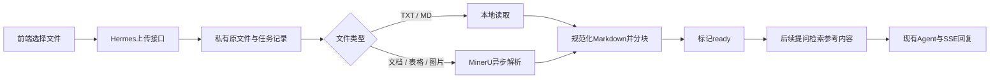

# Hermes 参考资料上传与 MinerU 解析方案

## 1. 已确认的功能范围

- 在对话输入框**左下角**增加附件按钮，使用 `Attachments + Sender.Header` 展示文件。
- 第一版只支持对话输入框，**不增加智能组卷表单字段**。
- 支持 PDF、Word（DOC/DOCX）、PPT/PPTX、XLS/XLSX、PNG/JPG/JPEG、TXT/MD。
- 当前会话最多启用 **5 份资料，每份不超过 50MB**。
- 发送后的资料在当前会话持续生效，其他新建对话不自动继承。
- 允许只发送附件：AI 简短确认资料已准备好，不自动生成试卷或长摘要。
- 短资料全文参考，长资料按问题检索相关片段。

开发仍限定在前端 `src/pages/hermes/`、后端 `hermes/`。本轮仅规划，未修改代码。

官方依据：[Ant Design X Attachments](https://x.ant.design/components/attachments-cn/)；[MinerU API 文档](https://mineru.net/apiManage/docs)。当前精准解析文档支持上述复杂文档格式，上游另有单文件 200MB、200页限制；产品侧采用更小的 50MB 限制。

## 2. 前端交互与会话状态

**输入区布局**

- 左下角放文件附件按钮及数量徽标，发送按钮继续位于右下角。
- 点击按钮展开 `Sender.Header`，支持选择文件和拖入输入框区域。
- 文件卡片显示名称、大小，以及“上传中、排队中、解析中、可参考、失败”等状态；失败可重试。
- 附件列表最多两行，超出内部滚动。将附件区实际高度计入现有输入框高度限制，避免挤压正文或再次产生布局跳动。

**上传与发送**

- 示例中的 `beforeUpload={() => false}` 只是本地演示，正式实现使用 `customRequest` 上传到 Hermes。
- 上传完成不等于解析完成。前端使用独立解析状态，只有后端返回 `ready` 才显示“可参考”。
- 上传、解析均不调用聊天模型；用户点击发送后才发起 AI 请求。
- 输入文字时可以继续上传；所选资料尚未就绪时禁止发送，用户可等待或移除失败文件。
- 无文字时，仅当存在本次新增的可用附件，才允许发送。用户气泡显示文件卡片，不出现空白气泡。

**会话隔离与重试**

- 文件缓存、启用列表和待发送附件按 `conversation_id` 管理，异步回调只能更新其所属会话。
- 发送后保留当前会话的参考资料列表；后续提问自动携带当前启用的附件 ID。
- “取消参考”只影响后续请求，不删除历史消息，也不删除原消息重试需要的解析结果。
- 原消息保存当时的资料 ID 快照；重新生成时使用原快照，不混入后来上传或取消的资料。
- 新建对话、组卷表单创建的新会话均从空参考列表开始。

示例中的 `useEffect([])` 清理会捕获初始 `items`。正式实现用独立 URL 注册表管理预览地址，每个文件只创建一次，在移除或页面卸载时释放。

## 3. 后端解析流程与接口



**复用方式**

项目已有 MinerU 配置和文件解析模块，但现有后处理还会生成 Word、上传图片并更新全站文件记录。Hermes 新增自己的资料适配层，复用已有配置读取能力，不直接套用整条后处理链。

- TXT/MD 本地读取，保留文本和 LaTeX，不提交 MinerU。
- 其他格式使用精准解析 `vlm`，开启公式与表格识别。
- 通过 `POST /api/v4/file-urls/batch` 申请上传地址，由后端 PUT 原文件；上传完成后 MinerU 自动创建解析任务，不重复调用提交接口。
- 后台轮询 `/api/v4/extract-results/batch/{batch_id}`。
- 完成后下载结果 ZIP，安全读取 `full.md`，规范化并建立片段索引。只有这些步骤成功才标记 `ready`。

这种方式不要求把原文件公开到 OSS，也不依赖开发环境能接收公网回调。MinerU Token 只在后端使用。

**新增接口，前缀 `/api/hermes/v1`**

| 接口                                        | 用途                                                                      |
| ------------------------------------------- | ------------------------------------------------------------------------- |
| `POST /reference-files`                     | 上传文件及 `conversation_id`，返回附件 ID 和解析状态，使用 202 表示已接受 |
| `GET /reference-files?conversation_id=…`    | 批量查询文件状态、页数进度和失败原因，不反复返回全文                      |
| `POST /reference-files/{id}/retry`          | 重试失败任务，复用已保存原文件                                            |
| `GET /reference-files/{id}/download`        | 鉴权下载原文件                                                            |
| `DELETE /reference-files/{id}`              | 移除未发送附件、取消本地任务并回收文件                                    |
| `DELETE /reference-files?conversation_id=…` | 用户删除会话时清理对应资料                                                |

已用于历史消息的资料，输入框关闭按钮执行“取消参考”，不调用物理删除接口。

**任务与存储**

- 新增 Hermes 资料记录与片段表，保存用户、会话、文件信息、解析任务 ID、状态、错误及不可变解析结果。
- 原文件保存在 Hermes 私有持久化目录，不通过静态目录公开；长 Markdown 使用兼容 MySQL 长文本的字段。
- 模块内后台工作器并发处理最多2份文件；前端每2秒读取状态，查询接口不重复提交云端任务。
- 任务持久化并在服务启动后恢复未完成作业，避免浏览器关闭或服务重启后丢失进度。
- 校验实际文件类型和大小，限制结果包大小、安全解压，拒绝空解析结果。接口逐一检查用户归属，会话引用再检查会话绑定。
- 云端已提交任务不承诺立即撤销；本地取消后停止使用其结果。

## 4. 如何把资料交给 AI

扩展现有聊天请求，保留标准历史消息：

```json
{
  "task": "chat",
  "conversation_id": "当前会话ID",
  "reference_ids": ["ref-1", "ref-2"],
  "messages": [
    {
      "role": "user",
      "content": "请结合附件解释这个知识点"
    }
  ]
}
```

- 前端只传附件 ID，不传解析全文、MinerU 下载地址或密钥。
- 后端确认资料属于当前用户和会话，且均已就绪，再组装参考内容。
- `conversation_id`、`reference_ids` 由本地后端消费，在调用上游前剔除，现有 SSE 协议不变。
- 无附件时沿用普通聊天请求；有附件也不触发组卷提示词。组卷规则仍仅在提交组卷表单时拼接。
- 参考内容作为独立资料块加入模型请求，不写回前端聊天正文，并明确资料中的指令不能覆盖系统规则。
- 仅发送附件时，后端生成简短确认要求，不声称模型已经完整阅读长文件。

**长资料策略**

- 参考资料包默认最多24,000字符，可在后端配置；内容和来源标识均计入预算。
- 能放入预算的短资料完整提供。
- 长资料按标题、段落切分，目标片段约1,000字、重叠150字；公式保持完整，长表格按行切分并保留表头。
- 第一版使用中文双字、英文词项的 BM25 检索，最多选择12个相关片段，不引入向量数据库或额外模型调用。
- 每个片段标明文件名、章节及片段编号，要求回答标注来源。没有可靠匹配时要求用户指定资料或章节，不伪称参考了全文。
- 附件请求的总输入默认限制64,000字符，可配置；历史本身已超预算时明确提示，不静默删除聊天记录。

这里的字符预算是应用限制，不代表上游模型的官方 token 上限，部署时需与实际模型能力匹配。

## 5. 验收与默认边界

**核心验收**

- 文件选择、拖入、多文件、超限、伪装格式、取消和失败重试。
- 上传成功但仍在解析时不可发送；真正 `ready` 后才可作为参考。
- 仅发送附件能正常确认；文字加附件能回答资料中的内容。
- 同一会话持续引用、取消后不再注入原文，新建会话不串资料。
- 切换会话时旧解析响应不污染新会话；重试原消息使用原资料快照。
- 短文全文、长文检索、公式表格边界、来源标识及超预算提示。
- MinerU 超时、鉴权失败、空结果、后台任务恢复，以及其他用户无法访问资料。
- 回归现有组卷、过程折叠、分栏动画、打印和导出。

**第一版默认边界**

- 沿用当前 Hermes 的页面内会话机制，不同时新增完整聊天历史持久化。
- 未发送的孤立附件24小时回收；已发送资料随会话删除清理，默认30天未使用过期，均可配置。
- 图片以解析出的文字、公式和表格供模型参考；不新增多模态模型接口。
- 不做全站资料库、组卷表单资料选择或向量检索；未来可以在现有附件 ID 协议上继续扩展。
